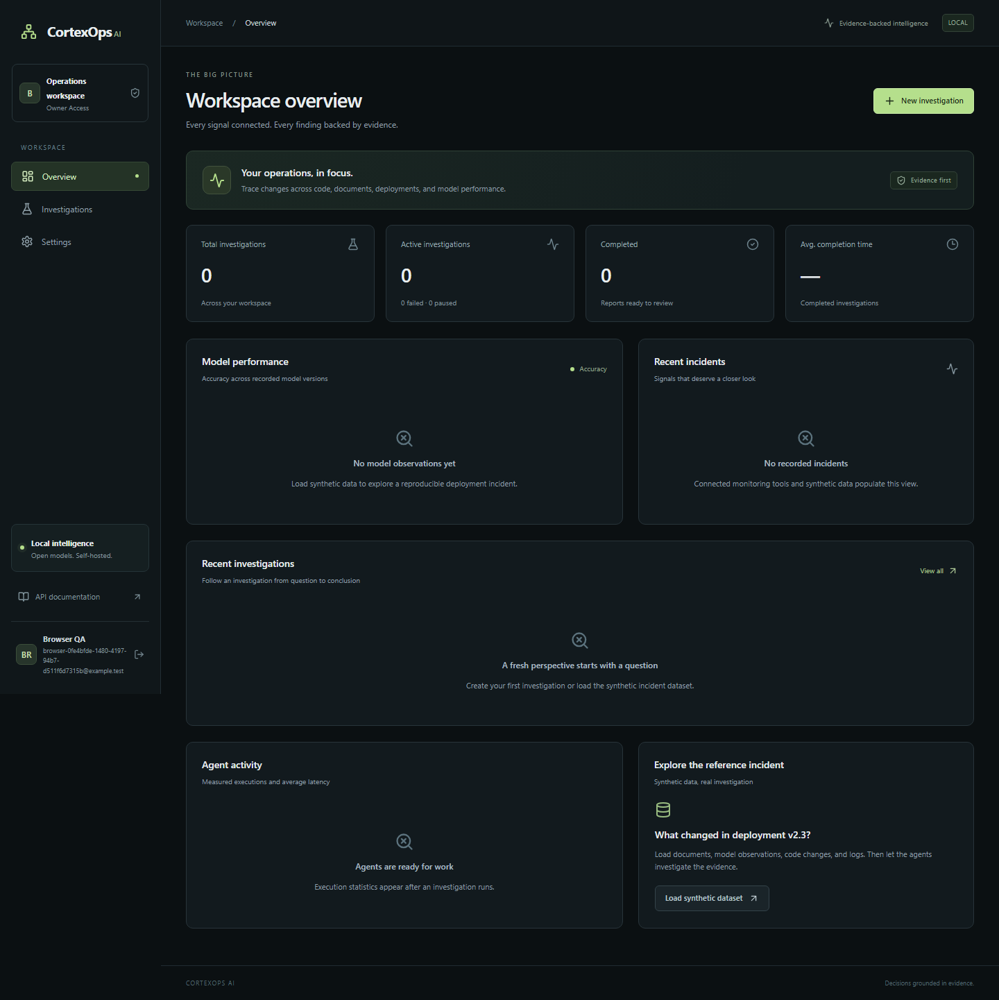
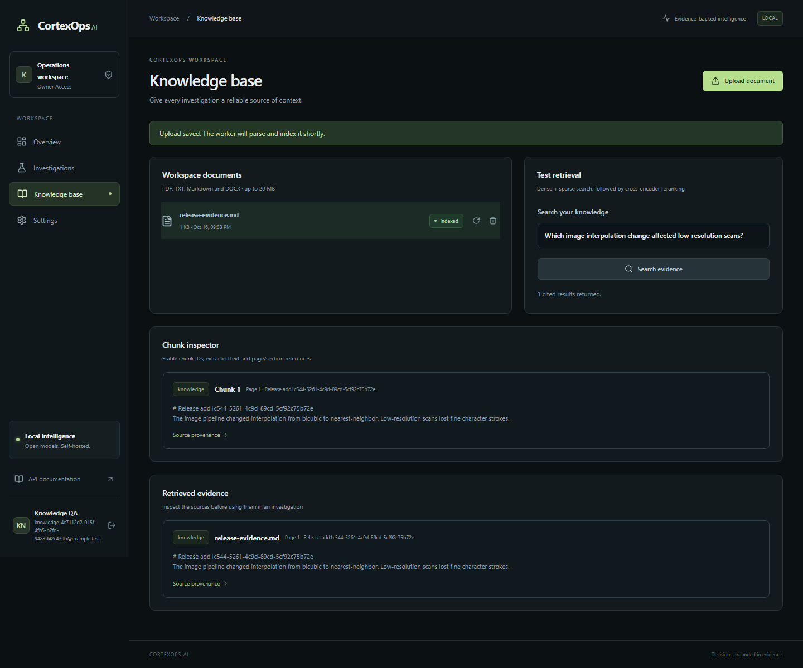

# CortexOps AI

A local-first investigation platform connecting operational metrics, documents,
code changes and logs into evidence-backed reports. Implementation proceeds in
tested milestones, with synthetic data and no required paid model API.

## Current status

**Checkpoint saved for the next session.** Phases 1–5 are implemented and tested,
including CPU-model investigations, permission failure/checkpoint resume, a cited
regression report, Neo4j graph synchronization and PDF/Markdown export. The latest
complete backend regression passed **21 tests in 436.98 seconds** (3 SDK deprecation
warnings in a test helper). Phase 6 deployment/browser/evaluation verification is
unfinished. See [resume notes](docs/NEXT_SESSION.md) for the exact next steps.

| Milestone | Status | Acceptance check |
| --- | --- | --- |
| Prerequisites | Complete | CPU models, databases and browser verified |
| 1. Foundation | Implemented | 6 backend tests and 1 browser test passed |
| 2. Knowledge | Complete | 3 backend tests and 1 real browser workflow passed |
| 3. MCP tools | Verified | 2 integration tests across 5 real SDK servers passed |
| 4. Orchestration | Verified | 2 real workflow tests passed in 222.20s; 5 validation tests passed |
| 5. Reports/graph | Verified | 3 graph/PDF/workspace integration tests passed in 23.14s; PDF visually inspected |
| 6. Operations | In progress | Compose, telemetry, evaluations and CI written; runtime/browser checks pending |

## Architecture

The [operations guide](docs/OPERATIONS.md) covers container/native modes, optional
Neo4j/observability profiles, metrics, recovery and production deployment boundaries.
The [evaluation guide](evaluation/README.md) explains real HTTP evaluation cases
and the limits of retrieval/citation smoke-test metrics.

[Architecture and specifications](docs/ARCHITECTURE.md) cover component ownership,
data flows, database relationships, API endpoints, agent workflow, MCP contracts,
security decisions and acceptance gates. The [original brief](docs/PROJECT_BRIEF.txt)
is preserved unchanged. The running API provides [interactive docs](http://127.0.0.1:8000/docs)
and [OpenAPI JSON](http://127.0.0.1:8000/openapi.json).

```text
React/Vite → FastAPI → PostgreSQL
                 ↘ Redis → Celery → LangGraph → Ollama + MCP
                              ↘ parsing/embeddings → Qdrant
                              ↘ optional Neo4j projection
```

## Run locally on Windows

Prerequisites: Python 3.12, Node 24, uv, Git, Docker Desktop/WSL 2, Ollama.
See [setup guide](setup/SETUP.md) and [verification inventory](setup/STATUS.md)
for exact versions, licenses, CPU models and resource notes for this 16 GB laptop.
Open Docker Desktop, then run from this directory:

```powershell
python .\setup\init-environment.py
python .\setup\configure-app.py
docker compose -f compose.prerequisites.yml up -d --wait
Push-Location backend
uv sync --locked --group dev
.\.venv\Scripts\alembic.exe upgrade head
.\.venv\Scripts\python.exe -m app
```

Leave that API terminal running. In another terminal:

```powershell
cd "C:\Users\Shobin Sam\Desktop\AIOps\cortexops-ai\frontend"
npm.cmd ci --no-fund
npm.cmd run dev
```

Open [localhost:5173](http://127.0.0.1:5173/), choose **Create a workspace** and supply
your own credentials (password minimum 12 characters). No login credentials are
bundled. Tokens stay in browser memory; refresh uses rotating HttpOnly/SameSite
cookies. Use 127.0.0.1 consistently to keep cookies on the same hostname.

```powershell
# Check and stop infrastructure while preserving data:
docker compose -f compose.prerequisites.yml ps
.\backend\.venv\Scripts\python.exe .\setup\verify-services.py --skip-inference
docker compose -f compose.prerequisites.yml stop
```

`stop` preserves volumes. `down --volumes` deletes stored data; do not use it for
routine shutdown. Stop native API/frontend terminals with Ctrl+C.

## Docker application deployment

```powershell
docker compose up -d --build --wait
```

The authored application Compose file reuses the prerequisite services, builds
the API/SPA, migrates PostgreSQL before API startup, and serves through Nginx at
[localhost:8080](http://127.0.0.1:8080). The complete image build remains unverified;
native API/browser integration has passed. Worker/MCP/monitoring containers follow
in later milestones. Core service images are digest-pinned; optional Neo4j uses the
`full` profile. Development ports bind to loopback. Uploads use a named volume,
embedding models mount read-only, and Ollama uses host.docker.internal.

## Configuration

`.env.example` is the configuration reference. `init-environment.py` generates
database passwords; `configure-app.py` generates the JWT secret, including when an
existing key is empty. Existing nonempty secrets are preserved. `.env`, uploads,
model caches and logs are Git-ignored; no credentials are returned to the frontend.

| Variable | Purpose |
| --- | --- |
| POSTGRES_PASSWORD/HOST/PORT/DB/USER, DATABASE_URL | Database connection; optional full URL override |
| JWT_SECRET | Server-only signing secret, minimum 32 characters |
| REDIS_URL, QDRANT_URL | Queue/rate-limit service and vector store |
| OLLAMA_BASE_URL, OLLAMA_MODEL | Model service and default model |
| EMBEDDING_MODEL, RERANKER_MODEL | Model identifiers or cached local directories |
| COOKIE_SECURE, APP_ENV, ENABLE_DEMO | Production rejects insecure cookies or enabled seeding |
| UPLOAD_DIR, MAX_UPLOAD_BYTES | Durable storage and upload limit |
| ANALYTICS_DATABASE_URL | Separate read-only analytics role |
| GITHUB_TOKEN, GITHUB_REPOSITORY | Optional GitHub integration; not exposed to browser |
| NEO4J_URI/PASSWORD, OTEL_EXPORTER_OTLP_ENDPOINT | Optional graph and tracing services |

Production needs TLS, Secure cookies, backups and disabled demo seeding. Workspace
admins configure a model name/context/temperature, not arbitrary inference URLs.

## Tests and recorded results

From `backend/`:

```powershell
.\.venv\Scripts\python.exe -m pytest tests/test_foundation.py -q
```

Tests create a uniquely named temporary PostgreSQL database, apply real migrations,
use Redis database 15 for rate limiting, then drop only that test database. Six
tests passed: auth, refresh rotation/reuse and family revocation, workspace isolation,
viewer permissions, validation redaction, origin checking/logout, dashboard/audit.

From `frontend/`, with API and Vite running:

```powershell
npm.cmd run build
$env:PLAYWRIGHT_BROWSERS_PATH = Join-Path (Split-Path -Parent (Get-Location).Path) '.cache\ms-playwright'
npm.cmd run test:e2e
```

One browser test passed: register a QA workspace with random credentials, create
an investigation through the UI, reload to verify persistence and check mobile
navigation. It uses real API/database responses and leaves that QA workspace in
the local application database. No external system is changed. The production
TypeScript/Vite build passed after the shadcn import correction; its initial
721 KB JavaScript bundle will be split as feature pages land.

## Phase 2 implementation (verified)

The knowledge page supports PDF/TXT/Markdown/DOCX uploads, processing status,
chunk inspection, reindexing, deletion, queued retrieval tests and source previews.
Files are streamed with a 20 MB limit, stored under workspace-specific generated
paths, checked for valid PDF/DOCX structure, and deduplicated by workspace/hash.
DOCX expansion limits reject archive bombs; encrypted and scanned-only PDFs fail
with an explicit explanation rather than invented text.

Celery handles parsing, embeddings, Qdrant indexing and cross-encoder reranking.
Durable `background_jobs` rows expose progress/errors through `GET /jobs/{id}`.
The upload/search API returns HTTP 202 and a job ID; the UI polls until completion.
Workers use session-level PostgreSQL advisory locks to prevent concurrent duplicate
delivery and retain retryable durable input after failures.

Retrieval uses normalized 384-dimensional dense vectors and stable hashed sparse
term-frequency vectors with Qdrant IDF weighting, reciprocal rank fusion, and a
CPU cross-encoder. Both prefetch branches filter workspace IDs. Returned chunks
are checked against canonical PostgreSQL rows and indexed document status, so
stale vector points cannot bypass deletion or workspace isolation. Citations
contain filename, document/chunk ID, page, section and source hash.

New files: `app/rag/{parsing,retrieval}.py`, `app/services/{knowledge,jobs}.py`,
`app/workers/{celery_app,tasks}.py`, `app/api/knowledge.py`, a background-job
migration, `frontend/src/pages/Knowledge.tsx`, and `tests/test_knowledge.py`.
`CHUNK_SIZE` (default 1500 characters) and `CHUNK_OVERLAP` (200) are configurable.
This baseline sparse encoder is lexical hashing with IDF, not a learned sparse
encoder or an asserted benchmark-quality BM25 implementation.

For local Windows verification, a separate Celery process can use its solo pool:

```powershell
# From backend/, in a third terminal:
.\.venv\Scripts\python.exe -m celery -A app.workers.celery_app:celery worker --pool=solo --concurrency=1 --loglevel=info
# Run the real worker/vector integration tests:
.\.venv\Scripts\python.exe -m pytest tests/test_knowledge.py -q
```

Celery does not officially support Windows. The supported deployment is the
Linux `worker` container in `docker-compose.yml`; the solo command is a local
development convenience. Tests launch a separate worker on a uniquely named test
queue and an ephemeral test database. Phase 2 is not marked complete until these
checks pass. Recorded result: **3 backend tests passed in 94.96 seconds** and
**1 browser upload/search test passed in 49.5 seconds**, using real local models,
Celery, PostgreSQL and Qdrant. The knowledge screenshot is available below.
A Docker Desktop shutdown interrupted the first migration attempt;
database connection timeouts now fail promptly instead of hanging.

## Phase 3 implementation (verified)

Five official-SDK Streamable HTTP MCP servers are implemented in `backend/app/mcp`.
See [server startup and contracts](mcp-servers/README.md). Discovery, typed tool
schemas/results, per-workspace permissions, tool history and an approval inbox
are available in the interface. The API cannot register an arbitrary destination;
clients only connect to the configured fixed MCP endpoints.

Provision read-only analytics once after migrations:

```powershell
cd backend
.\.venv\Scripts\python.exe -m app.cli setup-analytics
.\.venv\Scripts\python.exe -m pytest tests/test_mcp.py -q
```

The operator command generates separate credentials, grants SELECT only on
`analytics_model_observations` and `analytics_deployments`, and sets the role's
default transaction mode read-only. No tool accepts arbitrary SQL or shell commands.
MCP requests carry short-lived audience-specific JWTs; the server rechecks current
membership, tool permissions and investigation scope. Tests use separate ports
9101–9105, a temporary role/database and an isolated queue.

Writes first create an exact-payload SHA-256 approval. Only an admin/owner can
approve/reject; approvals expire after 30 minutes and are consumed once. Execution
runs through a queued job and the server checks the hash, tool, workspace, approver,
expiry and consumption state again. Ambiguous external network failures are not
automatically retried. Synthetic issue creation writes a real local incident,
explicitly labeled; live GitHub requires operator-set GITHUB_TOKEN,
GITHUB_REPOSITORY and GITHUB_WORKSPACE_ID. Other workspaces cannot use that token.

The synthetic reference dataset now includes 2,000 actual stored observations,
deployments, logs, code patches and six documents (including irrelevant and
prompt-injection evaluation documents). Seeding is owner-only and idempotent.
Tools compute metrics from these rows; no investigation answer is precomputed.

**Recorded result:** 2 Phase 3 tests passed in 73.33 seconds. They exercised all
five servers' protocol discovery, observed 98%/91% via SQL aggregation, compared
subgroups, denied unapproved/direct writes, executed an approved local write once,
rejected replay and foreign-workspace approval, and enforced tool revocation.

## Screenshots

## Phase 4 implementation (verification in progress)

The LangGraph pipeline now contains supervisor, planner, retrieval, data-analysis,
code-investigation, monitoring, diagnosis, citation-validation and reporting nodes.
Planning and diagnosis use real structured Qwen3 outputs with Pydantic validation
and one bounded repair attempt. Numerical comparisons use deterministic SQL/Python.
Model-authored explanations are always labeled hypotheses; a citation-ID check is
not presented as semantic entailment or causal proof. Invalid citations trigger a
bounded repair or are discarded with an explicit report limitation.

LangGraph checkpoint tables are initialized at API startup and excluded from
application-schema autogeneration. Jobs and investigations use PostgreSQL session
advisory locks to prevent duplicate execution; they commit the lock-acquisition
transaction before long-running work. This fixed an integration-test deadlock where
concurrent checkpoint-index creation waited on the job's own open transaction.

Investigations use a separate `cortexops.investigations` Celery queue/worker.
Document ingestion/search use `cortexops`. This avoids a solo worker deadlocking
when an investigation waits for MCP knowledge retrieval to queue a search.
Pause is cooperative at the next node boundary and saves a persistent interrupt;
resume uses the same checkpoint/thread ID. Cancel prevents subsequent nodes or
report finalization after the current bounded operation returns. Failed nodes
retain their checkpoint for resume. Tool/LLM calls and active execution time have
budgets; paused wall time does not consume the active-time budget.

Execution events are committed before Redis notification. Authenticated WebSockets
replay durable ordered events after a sequence cursor, recheck membership/token
validity, and bound concurrent connections. The frontend displays real agent
states, attempts, timings, token counts, calls/results, events and report links.
Markdown reports preserve supporting/contradictory citation IDs and limitations.

The PowerShell launcher starts the API, two workers, five MCP servers and Vite
with hidden windows and per-service logs:

```powershell
.\setup\dev.ps1 -Action start
.\setup\dev.ps1 -Action status
.\setup\dev.ps1 -Action stop
```

Stop validates recorded process creation times before terminating only its owned
process trees. Infrastructure volumes remain intact. Linux containers remain the
supported Celery deployment; native solo workers are development convenience.

## Screenshots

Actual browser-test capture:



[Mobile screenshot](docs/screenshots/mobile.png)



## Phase 1 files and responsibilities

- `backend/app/core/`: settings, async database sessions, JWT/role/origin checks.
- `backend/app/models/entities.py`: normalized application/operational schema.
- `backend/app/schemas/contracts.py`: typed API and evidence/agent contracts.
- `backend/app/services/auth.py`: registration, login, token rotation, source provisioning.
- `backend/app/api/foundation.py`: dashboard, auth, investigation CRUD, members/settings/audit.
- `backend/app/main.py`: health, rate limiting, errors and Prometheus metrics.
- `backend/alembic/`: executable initial migration; `backend/tests/`: database integration tests.
- `frontend/src/`: responsive UI, session/API client, query cache and shadcn components.
- Dockerfiles, Nginx and Compose: container packaging; `frontend/tests/`: browser checks.

## Troubleshooting

- Docker pipe access denied: verify Docker Desktop's Linux engine and shell access.
  The restricted Codex shell needs an approved Docker operation.
- Windows psycopg async-loop error: use `python -m app`; initialization selects the
  Windows selector loop required by psycopg/Python 3.12. Alembic shares this fix.
- Missing JWT secret: run `python setup/configure-app.py`.
- Refresh 401 after reload: keep hostname consistent; avoid mixing localhost/127.0.0.1.
- Login 429: auth is limited to 15 requests/minute per client IP; wait for reset.
- Slow model download: use cached models and setup's bounded HTTPS download helper.
- shadcn generator: corrected its `cn` import to `@/lib/utils` and removed the
  unintended extra npm dependency before production build verification.

## Development journal

- **16 October 2026 — prerequisites:** verified CPU dependencies, WSL/Docker,
  databases, Ollama/Qwen3, embedding/reranker inference and Chromium.
- **16 October 2026 — Phase 1:** architecture/contracts, normalized migration,
  authentication/rotation/RBAC, workspace management, dashboard/draft investigations,
  Docker packaging, six passing backend and one passing browser tests. Fixed
  Windows event-loop compatibility, empty-secret initialization and UI generator import.
- **16 October 2026 — Phase 2:** bounded uploads, durable Celery ingestion,
  parsing/chunking, hybrid retrieval, reranking, citations and deletion/reindexing.
  Three backend tests and one real browser workflow passed. Restored Docker after
  its engine stopped; added short connection timeouts. Search results revalidate
  canonical chunk ownership/status before exposing persisted job results.
- **16 October 2026 — Phases 3–5:** five real MCP servers, restricted analytics,
  exact-action approvals, checkpointed LangGraph investigation, live UI execution,
  citation validation, report exports, workspace switching and provenance graph.
  A real Neo4j/PDF/workspace test run passed 3 tests; the sample PDF was rendered
  and visually inspected. Full backend regression passed 21 tests in 436.98s.
- **16 October 2026 — Phase 6 checkpoint:** page bundles, complete Compose services,
  Prometheus/Grafana/collector configuration, structured request/job logs,
  worker-inclusive metrics, evaluation cases/runner and GitHub Actions written.
  Full container startup, updated browser suite, real evaluation run and final
  documentation cleanup remain. See `docs/NEXT_SESSION.md` before resuming.
- **17 October 2026 — checkpoint verification:** the background Docker build
  completed successfully for backend and frontend images. Full container startup
  and the remaining Phase 6 checks are still pending.
