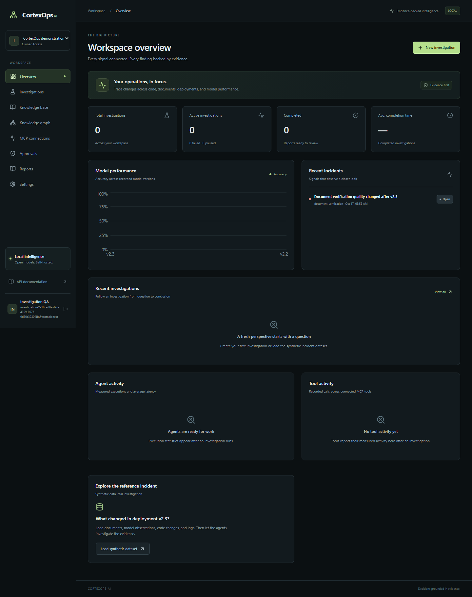
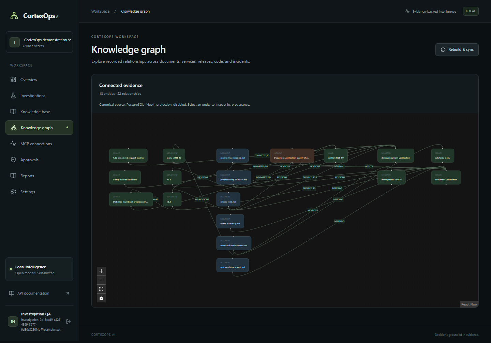
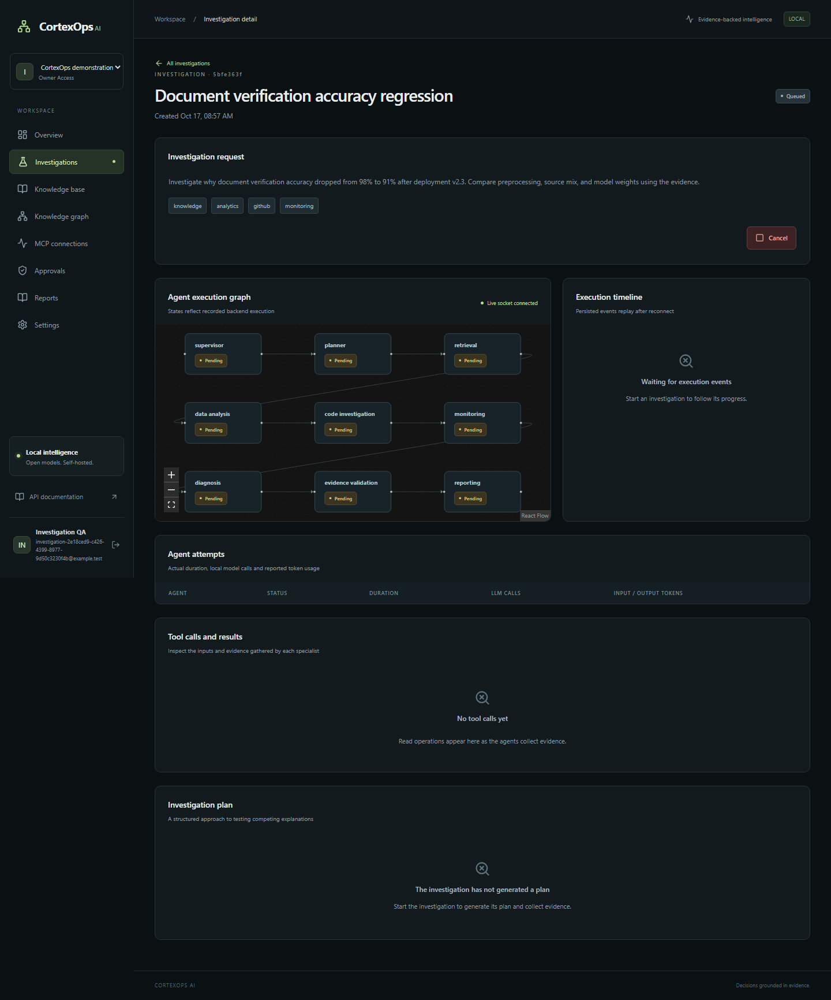

# CortexOps AI

A self-hosted investigation platform that connects documents, operational metrics,
repository changes and monitoring records into cited reports. React/TypeScript,
FastAPI, LangGraph, official MCP SDK servers, Qdrant and local Ollama inference.
No paid model API is required.

Ask: **“Why did document verification accuracy fall from 98% to 91% after v2.3?”**
The platform plans the investigation, gathers real source records, calculates
comparisons, selects evidence-supported hypotheses, and produces a report.
External changes require a separate human approval of the exact action/destination.

## Status and verification

The complete local demonstration is implemented and verified through Nginx.
Detailed test scope, measured evaluation results and limits are recorded in the
[verification guide](docs/VERIFICATION.md).

| Check | Recorded result |
| --- | --- |
| Complete backend regression | **22 passed in 195.35s**, 3 deprecated test-helper SDK warnings |
| Real-model workflow | Pause, permission failure, checkpoint resume, source-bound regression report passed |
| Graph/PDF/workspace integration | **3 passed in 23.14s**, including actual Neo4j synchronization |
| Evidence validation | **6 passed**, including fabricated-citation rejection and honest insufficiency |
| Frontend production build | TypeScript/Vite build passed; route bundles split |
| Docker deployment | Backend/frontend images built; init, API, two workers, five MCP servers and Nginx started |
| Browser | **4 passed in 3.0 minutes** against Nginx, including real inference and PDF download |
| Observability | Real collector spans, Prometheus worker gauges and provisioned Grafana dashboard verified |
| Evaluation | Five real baseline scenarios; separate unrelated-query recheck abstained and produced no supported hypothesis |
| CI | [GitHub Actions passed](https://github.com/ShobinSamS/cortexops-ai/actions/runs/38998911293): Linux integration, build, static and browser checks |

Tests use real isolated databases, queues, model inference and SDK round trips.
Mocks are limited to focused evidence-validation tests. This is an engineering
showcase with production-oriented controls; see [deployment boundaries](docs/OPERATIONS.md).

## Quick start on this Windows machine

Prerequisites: Python 3.12, Node 24, uv, Git, Docker Desktop with WSL 2 and Ollama.
They are installed on the development machine. Detailed versions and licenses:
[setup guide](setup/SETUP.md), [inventory](setup/STATUS.md).

From the project root in PowerShell:

```powershell
python setup/init-environment.py
python setup/configure-app.py
Push-Location backend
uv sync --locked --group dev
Pop-Location
Push-Location frontend
npm.cmd ci --no-fund
Pop-Location
.\backend\.venv\Scripts\python.exe setup/cache-models.py
ollama pull qwen3:1.7b
```

Open Docker Desktop and Ollama. The model helper downloads CPU embedding/reranker
weights, records pinned revisions and checksums, verifies cached files and runs
real inference. The first download can take several minutes. CPU PyTorch uses
its explicit package index; CUDA is unnecessary on this laptop.

Choose one application mode at a time:

```powershell
# Native application + container databases; all 9 application processes:
.\setup\dev.ps1 -Action start
.\setup\dev.ps1 -Action status
# Open http://127.0.0.1:5173

# Stop before switching to container mode:
.\setup\dev.ps1 -Action stop
docker compose up -d --build --wait
# Open http://127.0.0.1:8080
```

The launcher provisions core services, migrations and restricted analytics before
starting the API, two workers, Vite and five MCP servers in hidden windows.
Container mode provisions them through the one-shot `init` service and Nginx.
Ollama must be reachable from `host.docker.internal:11434`; this was verified on
the development machine. See [operations](docs/OPERATIONS.md) if host binding differs.

Create a workspace with your own email/password (minimum 12 characters). There
are no bundled login credentials. Use `127.0.0.1` consistently for cookie storage.
Access tokens remain in memory; refresh tokens use rotating HttpOnly cookies.

## Run the synthetic incident

1. On Overview, select **Load synthetic dataset**. Only the workspace owner can seed.
2. In Knowledge base, wait for the six documents to show **indexed**.
3. Create an investigation using the sample accuracy question, then select Start.
4. Follow the actual agent graph, events, tool inputs/results and token timings.
5. Review the completed report's observations, hypotheses, citations and limitations.
6. Export PDF/Markdown. A follow-up issue creates an approval request; inspect its
   destination and arguments in Approvals before approving or rejecting it.

The seed persists 2,000 observations, deployments, code patches, logs, an incident
and six reference/adversarial documents. Accuracy is calculated from those rows;
the root cause is not a stored answer. Stable source mix/model weights and the
low-resolution subgroup provide competing evidence. The model selects among
actual recorded changes, and report wording preserves the selected diff.
Reproduction is still required to establish causality.

## How an investigation works

```text
React + Nginx/Vite -> FastAPI -> PostgreSQL (workspace data, jobs, events, checkpoints)
                       |         ^
                       v         |
                   Redis -> Celery investigation queue -> LangGraph -> Ollama
                                |                           |
                      document/search queue <---- authenticated MCP servers
                                |
                      parsing -> embeddings -> Qdrant dense+sparse -> reranker
                                |
                      canonical knowledge graph -> optional Neo4j projection
```

The nine graph nodes are supervisor, planner, retrieval, data analysis, code
investigation, monitoring, diagnosis, evidence validation and reporting. Planning
and diagnosis use structured local model outputs. Numerical analysis, permissions,
citation checks, budgets and state transitions use deterministic code.

Document parsing supports text PDFs, UTF-8 TXT/Markdown and DOCX with bounded
uploads/expansion/text/chunk counts. Scanned PDFs require external OCR. PDF pages
retain physical page numbers; unpaginated formats use section references and
page `0`. Canonical chunks have stable UUIDs. Hybrid Qdrant retrieval fuses dense
and sparse results, expands through recorded graph relationships, and reranks
with a CPU cross-encoder. Workspace/document filters apply before retrieval and
canonical ownership/status is checked before returning evidence.
If the top reranked score falls below `RETRIEVAL_MIN_SCORE`, retrieval abstains.
This development logit threshold needs calibration for each model/corpus; it
does not establish semantic relevance or eliminate irrelevant context by itself.

Graph extraction uses explicit `Service:`, `Deployment:`, `Repository:`, `Model:`
and `Incident:` tags plus actual operational records. Edges preserve chunk/record
provenance. Neo4j is optional; bounded canonical PostgreSQL traversal remains
available when its projection is disabled/unavailable. Rebuild/sync is asynchronous.

Pause is cooperative at a node boundary. Resume consumes the persisted LangGraph
interrupt/checkpoint; a failed node can resume after its underlying issue is fixed.
Cancel prevents later nodes/final report after the current bounded operation returns.
Advisory locks prevent concurrent duplicate job/investigation execution.

## Pages

| Page | Behavior |
| --- | --- |
| Overview | Real workspace counts, version accuracy, incidents, agent/tool activity |
| Investigations | Create/filter/history, start/pause/resume/cancel, live recorded execution |
| Knowledge base | Upload, index, chunk inspector, document filter, cited search, reindex/delete |
| Knowledge graph | Interactive provenance graph and optional Neo4j synchronization |
| MCP connections | Discover contracts, permissions, JSON workbench, persisted execution history |
| Approvals | Exact arguments/destination/hash, expiry, admin decision and execution outcome |
| Reports | Verified numerical observations, hypotheses, recommendations, sources, PDF/Markdown |
| Settings | Workspace, members, configurable local model, audit trail |

The workspace selector switches only to current memberships and clears cached
workspace data. Viewer/analyst/admin/owner permissions are enforced server-side.

## MCP and source connections

Five independent official SDK servers expose typed tools over authenticated
Streamable HTTP: GitHub, read-only PostgreSQL analytics, knowledge, monitoring
and incidents. Native ports are 8101–8105; container URLs use private service names.
MCP JWTs have their own audience and workspace/investigation scope. Operators
configure endpoints; users/model outputs cannot choose arbitrary network targets.

Synthetic adapters read persisted local source records and identify their mode.
Only GitHub has an implemented optional live external adapter. Set server-only
`GITHUB_TOKEN`, `GITHUB_REPOSITORY=owner/repo`, and `GITHUB_WORKSPACE_ID` for its
allowed workspace, then restart. Never use the project-push Git credential as an
application secret. Unconfigured workspaces continue using local source records.

Analytics connects as a dedicated role that can SELECT only approved views.
It cannot read user password hashes, write source tables, or execute arbitrary
model-authored SQL. GitHub issue/local incident writes require an administrator,
current permission, exact destination/argument hash, expiry and single consumption.
There is no automatic retry of an ambiguous external write after a timeout.

## Configuration

`.env.example` lists configuration. Setup generates ignored secrets without
replacing existing nonempty values. Model weights, uploads, databases, dependency
directories, browser traces and logs are excluded from Git.

| Variables | Purpose |
| --- | --- |
| POSTGRES_PASSWORD/HOST/PORT/DB/USER, DATABASE_URL | Main database connection |
| JWT_SECRET, ACCESS_TOKEN_MINUTES, REFRESH_TOKEN_DAYS | Signing and session duration |
| REDIS_URL, CELERY_QUEUE, QDRANT_URL | Queues/rate limits, base queue and vectors |
| OLLAMA_BASE_URL/MODEL, EMBEDDING_MODEL, RERANKER_MODEL | Server-only model settings |
| LLM_TIMEOUT, INVESTIGATION_TIMEOUT, MAX_LLM_CALLS/TOOL_CALLS | Execution budgets |
| UPLOAD_DIR, MAX_UPLOAD_BYTES, CHUNK_SIZE/OVERLAP | Bounded storage/parsing |
| RETRIEVAL_MIN_SCORE | Query-level cross-encoder logit floor (default -6) |
| ANALYTICS_PASSWORD/DATABASE_URL | Dedicated restricted analytics credential |
| GITHUB_TOKEN/REPOSITORY/WORKSPACE_ID | Optional live GitHub adapter allowlist |
| NEO4J_URI/PASSWORD | Optional graph projection |
| OTEL_EXPORTER_OTLP_ENDPOINT, GRAFANA_PASSWORD | Optional local observability |
| APP_ENV, COOKIE_SECURE, ENABLE_DEMO, ALLOWED_ORIGINS/CORS_ORIGINS | Deployment policy |

Production requires secure cookies and disabled seeding. Deploy TLS, protected
registration/identity, private networks, least-privilege DB roles and backups.
The sample setup is loopback-only and includes no HA/SSO or independent audit.

## Tests and evaluations

```powershell
# Core services and Ollama must be running; run from backend:
Push-Location backend
.\.venv\Scripts\python.exe -m pytest tests -q
Pop-Location

# Browser suite against container mode (serial to fit this laptop):
Push-Location frontend
$env:E2E_BASE_URL='http://127.0.0.1:8080'
$env:E2E_LLM='1' # enables the slower real-model investigation browser test
.\node_modules\.bin\playwright.cmd test --workers=1
Pop-Location

# Real HTTP evaluation; creates isolated evaluation workspaces:
.\backend\.venv\Scripts\python.exe evaluation/run.py --base-url http://127.0.0.1:8080
.\backend\.venv\Scripts\python.exe evaluation/run.py --base-url http://127.0.0.1:8080 --case preprocessing-regression --investigate
```

Backend tests create/drop an ephemeral database and restricted analytics role;
they never reset application data. Tests reserve Redis database 15 and unique
queues. `CORTEXOPS_TEST_NEO4J=1` additionally requires the actual Neo4j service.
See [evaluation definitions and limits](evaluation/README.md). Citation-ID validity
does not measure semantic entailment; expected-term matching is a smoke check.

GitHub Actions builds the UI, runs non-LLM backend integration and browser checks.
Manual workflow input enables a slower real Ollama test. CPU tests run sequentially;
do not run a native stack and isolated test stack together on low available RAM.

## Documentation, API and source layout

- [Architecture, ER diagram, agents and contracts](docs/ARCHITECTURE.md)
- [Operations, monitoring, recovery, backups and boundaries](docs/OPERATIONS.md)
- [Evaluation](evaluation/README.md), [original brief](docs/PROJECT_BRIEF.txt)
- [Recorded acceptance checks and evaluation results](docs/VERIFICATION.md)
- Live [Swagger API](http://127.0.0.1:8000/docs), [OpenAPI JSON](http://127.0.0.1:8000/openapi.json)
- [MCP server ownership/startup](mcp-servers/README.md)

Backend ownership: `core/` settings/auth/database/telemetry; `models/` canonical
schema; `api/` HTTP/WebSocket routes; `services/` ingestion, approvals, graph,
reports and jobs; `rag/` parsers and retrieval; `agents/` structured inference and
LangGraph; `mcp/` SDK servers/tools; `workers/` separate queues. Alembic migrations
are under `backend/alembic/`. Frontend routes/components and API/session client
are under `frontend/src/`; browser checks under `frontend/tests/`. Infrastructure
contains actual Compose monitoring/provisioning configs. Lockfiles pin dependencies.

## Screenshots

Actual browser captures, not design mockups:






[Completed execution](docs/screenshots/execution.png), [report](docs/screenshots/report.png),
[MCP workbench](docs/screenshots/tools.png), [approval review](docs/screenshots/approvals.png),
and [mobile view](docs/screenshots/mobile.png). Exports from synthetic verification
are under `output/pdf/`.

## Troubleshooting

- Docker pipe missing: start Docker Desktop and wait for its Linux engine.
- Ollama connection failure: open Ollama, check `/api/tags`; for containers verify
  host reachability as described in the operations guide.
- Missing model files: run `setup/cache-models.py` using backend Python. It verifies
  pinned cached checksums; do not mix model revisions manually.
- Windows psycopg loop error: start with `python -m app`; package initialization
  selects the compatible Windows event-loop policy.
- Document queued/search waiting: inspect the base worker. Investigation jobs use
  a separate `.investigations` queue to avoid solo-worker deadlock.
- Permission failure: inspect tool history/audit, restore permitted access if
  appropriate, and Resume the failed investigation from its checkpoint.
- Login 429: 15 auth requests/minute per client IP; respect the reset. API limit
  is 240/minute. Cookie refresh/logout validate allowed origins.
- Reload loses session: keep hostname consistent and check cookie/security config.
- Neo4j unavailable: canonical graph still works; retry Rebuild & sync after service recovery.
- Interrupted worker: see the operator recovery procedure; no zombie-job sweeper is included.

Stop with `setup/dev.ps1 -Action stop` or `docker compose stop`. Named volumes
persist. `down --volumes` deletes data and is not a routine shutdown command.

Project source is [MIT licensed](LICENSE). Dependency/service/model licenses retain
their own terms; see the setup license inventory and linked upstream licenses.
