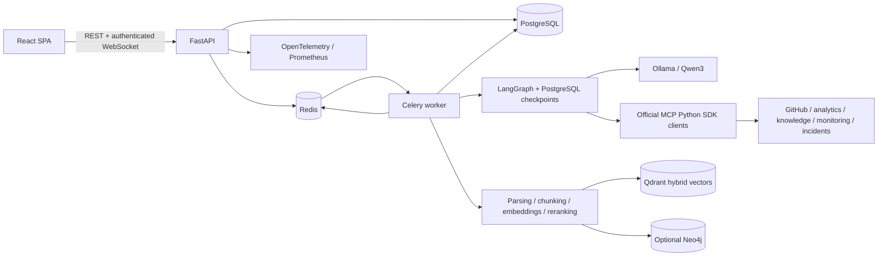
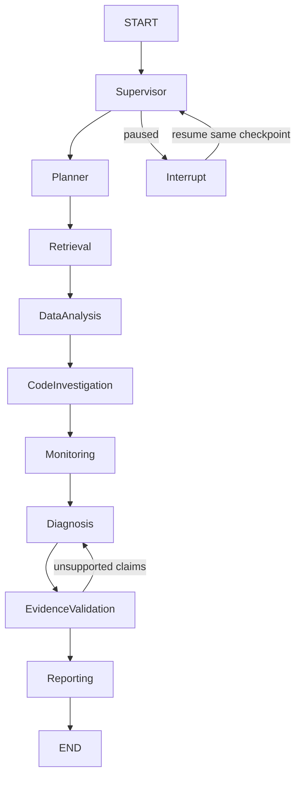

# CortexOps AI — implementation architecture

## System and ownership

The browser is a React/TypeScript/Vite SPA. FastAPI owns authentication, workspace
authorization and the public API. PostgreSQL is the system of record. Redis is the
Celery broker, event notification channel and rate-limit store. Celery workers
perform ingestion and run LangGraph investigations. Ollama runs inference locally.
Qdrant owns dense/sparse vectors; PostgreSQL retains canonical chunks/provenance.
Neo4j Community is an optional materialized relationship index, never the sole
copy of evidence. Services are replaceable behind explicit adapters.

## Boundaries and data flows

`api/` validates requests and calls services; `core/` handles configuration,
security and database sessions; `models/` owns the schema; `schemas/` owns public
contracts; `services/` owns transactions and lifecycle operations; `agents/` owns
the state machine and typed LLM calls; `rag/` owns ingestion/retrieval;
`mcp/` implements each tool exactly once; `graph/` owns Neo4j projection;
`workers/` provides Celery entry points. Top-level MCP launchers only select a
server kind and import the shared implementation.

Upload → validated durable file → document/job rows → Celery → parse by page or
section → normalize/chunk → stable IDs → CPU embeddings and sparse term vectors →
workspace-filtered Qdrant points → canonical chunk rows → optional graph index.

Query → embed and sparse tokenize → Qdrant prefetch → reciprocal rank fusion →
CPU cross-encoder rerank → source ownership/deletion validation → evidence records.
Retrieved text is untrusted content and cannot grant permissions or invoke tools.

Investigation → queued job → planner → approved read-only MCP calls → evidence
collection → statistical comparisons → grounded hypotheses → citation validation →
report. An optional external action becomes a separate approval record. A user
must approve the exact payload before a write tool can execute.

## Entity relationships

```mermaid
erDiagram
  users ||--o{ workspace_members : joins
  workspaces ||--o{ workspace_members : contains
  users ||--o{ refresh_tokens : authenticates
  workspaces ||--o{ investigations : owns
  investigations ||--o{ investigation_steps : records
  investigations ||--o{ agent_executions : measures
  investigations ||--o{ tool_executions : traces
  investigations ||--o{ investigation_events : streams
  investigations ||--o{ approvals : requests
  investigations ||--o| reports : produces
  workspaces ||--o{ documents : isolates
  documents ||--o{ document_chunks : contains
  workspaces ||--o{ data_sources : connects
  workspaces ||--o{ mcp_servers : permits
  workspaces ||--o{ model_configurations : configures
  workspaces ||--o{ audit_logs : audits
  workspaces ||--o{ graph_entities : projects
  graph_entities ||--o{ graph_relationships : connects
  workspaces ||--o{ model_observations : measures
  workspaces ||--o{ deployments : deploys
  workspaces ||--o{ application_logs : monitors
  workspaces ||--o{ repository_changes : investigates
  workspaces ||--o{ incidents : tracks
```

Application execution metadata is separate from LangGraph's checkpoint tables.
All workspace resources have foreign keys and workspace indexes. Stable chunk
IDs derive from document ID, content hash and chunk position. Lifecycle columns
have database CHECK constraints. Refresh tokens are hashed, rotated, single-use
and grouped into a revocable family. Tool calls retain the invoking user/workspace.

## API specification

All application paths start with `/api/v1`; JSON dates are UTC ISO 8601 and IDs are
UUID strings. Bearer access tokens live only in browser memory. Rotating refresh
tokens use HttpOnly cookies. The OpenAPI schema at `/openapi.json` is authoritative
for exact request/response fields once implementation is running.

| Area | Endpoints | Authorization |
| --- | --- | --- |
| Health | `GET /health/live`, `/health/ready`, `/metrics` | Health public; metrics deployment-private |
| Auth | `POST /auth/register`, `/login`, `/refresh`, `/logout`; `GET /auth/me` | Public entry points, rate limited |
| Dashboard | `GET /dashboard` | Member |
| Investigations | `GET/POST /investigations`; `GET /investigations/{id}` | Member / analyst+ for writes |
| Lifecycle | `POST /investigations/{id}/{start,pause,resume,cancel}` | Analyst+ |
| Execution | `GET /investigations/{id}/{events,steps,tools}`; `WS /ws/investigations/{id}` | Member; socket first message carries token |
| Knowledge | `GET/POST /documents`; `GET/DELETE /documents/{id}` | Member / analyst+ |
| Indexing | `GET /documents/{id}/chunks`; `POST /documents/{id}/reindex`; `POST /knowledge/search` | Member / analyst+ for reindex |
| MCP | `GET /mcp/servers`; `POST /mcp/servers/{id}/discover`; `POST /mcp/tools/invoke`; `GET /mcp/executions` | Analyst+ / permission checked |
| Approvals | `GET /approvals`; `POST /approvals/{id}/decision` | Admin+ for external writes |
| Reports | `GET /reports`; `GET /reports/{id}`; `GET /reports/{id}/export?format=md|pdf` | Member |
| Graph | `GET /graph`; `POST /graph/sync` | Member read; admin+ sync |
| Workspace | `GET /workspace`; `PATCH /workspace`; `GET /members`; `POST /members`; `PATCH /members/{id}` | Member / admin+ |
| Configuration | `GET/PUT /settings/model`; `GET /audit`; `GET /data-sources` | Admin+ / member for sources |
| Demo | `POST /demo/seed` | Owner; local synthetic data only |

Errors use `{detail, request_id}` and appropriate 400/401/403/404/409/413/422/429/503
status codes. Lists are bounded and accept pagination. No arbitrary SQL or shell
execution endpoint exists. WebSocket reconnects replay persisted events by sequence.

## Agent workflow

The supervisor wrapper enforces budgets, cancellation and cooperative pause at
node boundaries. Each node records start/completion/failure events and timings.
State contains request, source selection, plan, evidence, tool errors, hypotheses,
report, usage and validation feedback. LLM outputs use Pydantic schemas with
bounded repair attempts. Deterministic code computes metrics and verifies source
IDs. Failures retain checkpoints; resume continues from the failing node.
No agent invents missing evidence. Unavailable tools produce explicit limitations.

## MCP contracts

Each server uses official `mcp.server.fastmcp.FastMCP`, Streamable HTTP, typed
arguments/results, per-workspace bearer authorization, input bounds, audit rows
and operation timeouts. The application client uses `ClientSession` over the
official transport. Servers bind to private container networks or loopback.

| Server | Read tools | Approved write tools |
| --- | --- | --- |
| GitHub | list_repositories, get_recent_commits, compare_commits, get_pull_requests, get_changed_files | create_issue |
| Analytics | get_model_metrics, compare_model_versions, get_failure_distribution, get_deployment_statistics | None |
| Knowledge | search_knowledge, get_document, retrieve_evidence | None |
| Monitoring | get_application_logs, get_error_statistics, get_service_health, get_deployment_events | None |
| Incidents | list_incidents, get_incident | create_incident |

Synthetic demo repositories/deployments/observations/logs are real persisted local
data with explicit synthetic provenance. A local issue write creates a real local
incident/issue record only after approval; GitHub mode calls the real GitHub API
with an operator-supplied token. Adapters clearly expose their source mode.
Analytics tools connect with a database role restricted to approved read-only
views, not the application owner's credentials.

## Milestones and acceptance gates

1. **Foundation:** migrations, auth/rotation, workspace isolation, investigation
   CRUD, responsive dashboard, Docker entry points; prove API/browser integration.
2. **Knowledge:** document ingestion, Celery, real CPU embeddings, hybrid retrieval,
   reranking, citations and deletion; test upload→index→retrieve isolation.
3. **Tools:** five real MCP servers, discovery/invocation, read-only analytics,
   permissions and audit; test protocol round trips and write rejection.
4. **Orchestration:** LangGraph checkpoints, live event stream, agents, budgets,
   cancellation/pause/resume; run a real local-model investigation.
5. **Evidence and graph:** hypothesis validation, report export, approval execution,
   knowledge relationships and Neo4j projection; verify the synthetic cause.
6. **Operations:** observability, evaluation cases, CI, end-to-end/security tests,
   full deployment profile and reproducible documentation/screenshots.

## Decisions and limitations

- CPU Qwen3 1.7B, MiniLM embeddings and MiniLM reranker fit this 16 GB laptop.
  Model choices remain configurable; production accuracy is an evaluation outcome.
- Queue workers, not API handlers, run inference/parsing. Windows local worker
  validation may use Celery's solo pool; Linux containers are supported deployment.
- WebSocket events are persisted before publication, so Redis is not event history.
- No external write follows directly from an LLM response; approval is scoped to
  an arguments-and-destination hash, user/workspace, expiry and single consumption.
  A change between local and live GitHub modes invalidates the earlier approval.
- HTTP database dependencies use function scope so commits/errors finish before
  the response is sent. This prevents an immediate UI refetch reading stale writes.
- Code diagnosis selects actual recorded change IDs; wording derives from their
  before/after diff. Numeric observations are computed separately. Unchecked
  model-authored caveats cannot overwrite recorded source coverage.
- Retrieval applies a configurable query-level floor to the top cross-encoder
  logit. The default is a development calibration, not a probability/semantic
  guarantee. Low scores can produce an empty evidence set; diagnosis can abstain.
- RAG vectors and graph projections are rebuildable; canonical files/chunks remain
  in durable storage. Development volume storage is not a backup strategy.
- Observability, evaluations and security checks provide evidence of behavior;
  they do not imply a completed independent production security audit.

References: [LangGraph interrupts](https://docs.langchain.com/oss/python/langgraph/interrupts),
[persistence](https://docs.langchain.com/oss/python/langgraph/persistence),
[Qdrant hybrid queries](https://qdrant.tech/documentation/search/hybrid-queries/).
